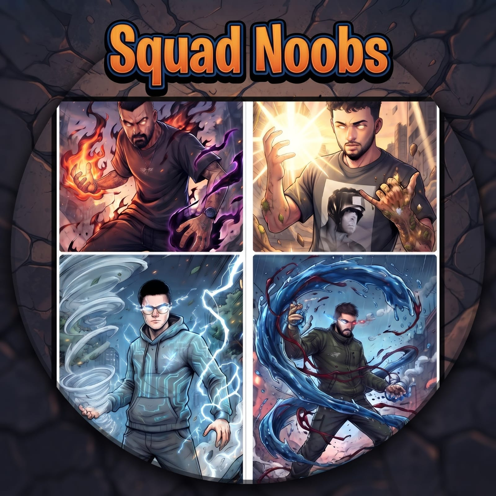
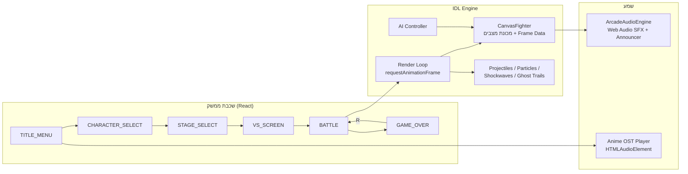

<div dir="rtl" align="right">

<p align="center">
  <a href="https://squad.idlhq.co.il/" target="_blank">
    
  </a>
</p>

<h1 align="center">⚔️ SQUAD NOOBS ⚔️</h1>
<h3 align="center">אליפות קרבות הרחוב של ארבעה חברים · משחק לחימה 2D בסגנון אנימה</h3>

<p align="center">
  <a href="https://squad.idlhq.co.il/"></a>
</p>

<p align="center">
  
  
  
  
  
  
  
  
</p>

---

## 📑 תוכן עניינים

1. [אודות המשחק](#-אודות-המשחק)
2. [תכונות עיקריות](#-תכונות-עיקריות)
3. [הלוחמים](#-הלוחמים)
4. [זירות הקרב](#-זירות-הקרב)
5. [מצבי משחק](#-מצבי-משחק)
6. [מערכת הלחימה](#-מערכת-הלחימה)
7. [בקרה ומקשים](#-בקרה-ומקשים)
8. [התקנה והפעלה](#-התקנה-והפעלה)
9. [ארכיטקטורה](#-ארכיטקטורה)
10. [מבנה הפרויקט](#-מבנה-הפרויקט)
11. [התאמה אישית](#-התאמה-אישית)
12. [פתרון בעיות נפוצות](#-פתרון-בעיות-נפוצות)
13. [מפת דרכים](#-מפת-דרכים)
14. [קרדיטים ורישיון](#-קרדיטים-ורישיון)

---

## 🌟 אודות המשחק

**SQUAD NOOBS** הוא משחק לחימה ארקייד דו-ממדי שרץ ישירות בדפדפן, ללא התקנה וללא תוסף.
ארבעה חברים, ארבעה יסודות, זירה אחת. המשחק משלב אסתטיקת אנימה עם מכניקות של משחקי לחימה קלאסיים:
ניהול פריימים, שרשראות קומבו, אולטימייטים קולנועיים וסיומי קרב דרמטיים בהשראת *Mortal Kombat*.

> 💡 כל האפקטים הקוליים מופקים בזמן אמת על ידי **Web Audio API**, והקרב כולו מצויר על גבי **Canvas** – בלי מנועי משחק חיצוניים.

---

## ⚡ תכונות עיקריות

| | תכונה | פירוט |
| :-: | :--- | :--- |
| 🧑‍🎤 | **4 לוחמים ייחודיים** | לכל לוחם שני יסודות, 5 מהלכים וסטטיסטיקות משלו |
| 🏟️ | **3 זירות** | רחוב ניאון, מקדש לבה ומנחת סערה |
| 🎮 | **3 מצבי משחק** | PVP, מול מחשב ואימונים |
| 🥊 | **קומבואים וביטולי מכה** | חלון ביטול, באפר פקודות ושרשראות Light → Light |
| 💥 | **Game Feel** | Hit-Stop, רעידות מסך, טבעות הדף וזנבות רוח בדאש |
| 🌀 | **אולטימייטים מסך מלא** | שדה אפקט ייחודי לכל לוחם וכרזת הכרזה |
| ☠️ | **FATALITY / BRUTALITY** | סיום קרב קולנועי עם קריין קולי |
| 🎵 | **פסקול אנימה** | נגן מוזיקה מובנה עם 5 רצועות ואפשרות לקישור מותאם אישית |
| 📱 | **תמיכה במגע** | פקדי מסך מגע אוטומטיים במכשירים נתמכים |
| 🖥️ | **מסך מלא** | מעבר בלחיצה אחת |
| ⚙️ | **הגדרות משחק** | מספר סיבובים, משך סיבוב, ווליום ומוזיקה |

---

## 🧑‍🎤 הלוחמים

<table>
  <tr>
    <td align="center" width="25%">
      <h3>⚡ איבן</h3>
      <b>Ivan</b><br>
      <sub>מאסטר הסערה והחשמל</sub><br><br>
      <code>רוח</code> + <code>חשמל</code>
    </td>
    <td align="center" width="25%">
      <h3>🔥 עידן</h3>
      <b>Idan</b><br>
      <sub>אגרוף התופת האפלה</sub><br><br>
      <code>אש</code> + <code>אפלה</code>
    </td>
    <td align="center" width="25%">
      <h3>⛰️ פיליפ</h3>
      <b>Philip</b><br>
      <sub>טיטאן הקריסטל והשמש</sub><br><br>
      <code>אור</code> + <code>אדמה</code>
    </td>
    <td align="center" width="25%">
      <h3>💧 רוני</h3>
      <b>Roni</b><br>
      <sub>אדון המים והדם</sub><br><br>
      <code>מים</code> + <code>דם</code>
    </td>
  </tr>
</table>

### 📊 סטטיסטיקות (מתוך 10)

| לוחם | 💪 כוח | 🏃 מהירות | 🛡️ הגנה | סגנון |
| :--- | :---: | :---: | :---: | :--- |
| **איבן** | `████████░░` 8 | `██████████` 10 | `███████░░░` 7 | מהיר וחד, שליטה בקצב |
| **עידן** | `██████████` 10 | `███████░░░` 7 | `████████░░` 8 | נזק גבוה, לחץ התקפי |
| **פיליפ** | `█████████░` 9 | `██████░░░░` 6 | `██████████` 10 | טנק איתן, הגנה חזקה |
| **רוני** | `█████████░` 9 | `████████░░` 8 | `████████░░` 8 | מאוזן, זורם וקטלני |

### 🥋 ארסנל המהלכים

לכל לוחם **5 מהלכים**: שתי מכות קלות (אחת לכל יסוד), שתי מכות כבדות (אחת לכל יסוד) ואולטימייט.

<details>
<summary><b>⚡ איבן – רוח וחשמל</b></summary>

| מקש | מהלך | יסוד | תיאור |
| :-: | :--- | :-: | :--- |
| קלה 1 | להב רוח חותך (Wind Blade) | רוח | חרמש רוח מהיר וחד |
| קלה 2 | אגרוף ברק מחושמל (Thunder Jab) | חשמל | אגרוף חשמלי שמשתק לרגע |
| כבדה 1 | סופת הוריקן הודפת (Gale Blast) | רוח | משב טורנדו שמעיף את היריב אחורה |
| כבדה 2 | מכת ברק שמיים (Sky Lightning Crash) | חשמל | ברק עבה שמחשמל את הזירה |
| 🌟 אולטימייט | טורנדו ברקים אימתני (Thunderstorm Tornado) | רוח + חשמל | טורנדו ענק עם ברקים שממלא את המסך |

</details>

<details>
<summary><b>🔥 עידן – אש ואפלה</b></summary>

| מקש | מהלך | יסוד | תיאור |
| :-: | :--- | :-: | :--- |
| קלה 1 | אגרוף ניצוץ אש (Fire Spark Jab) | אש | מהלומת להבה מהירה עם גיצים |
| קלה 2 | טופר אפלה מהיר (Dark Shadow Claw) | אפלה | מכת טופר עם הילה סגולה-שחורה |
| כבדה 1 | כדור אש תופת מתפוצץ (Hellfire Blast) | אש | כדור אש ענק שמתפוצץ בלשונות להבה |
| כבדה 2 | בור כבידה וגל אפל (Abyssal Void Slam) | אפלה | גל הדף שמעוות כבידה |
| 🌟 אולטימייט | כדור חושך ואש (Nether Dark Void Nova) | אש + אפלה | פיצוץ אש וחושך בעוצמה מחרישת אוזניים |

</details>

<details>
<summary><b>⛰️ פיליפ – אור ואדמה</b></summary>

| מקש | מהלך | יסוד | תיאור |
| :-: | :--- | :-: | :--- |
| קלה 1 | הבזק אור סולארי (Solar Flash Strike) | אור | אגרוף אור בוהק שמסנוור |
| קלה 2 | בעיטת קריסטל אבן (Crystal Stone Kick) | אדמה | בעיטה שיוצרת רסיסי קריסטל חדים |
| כבדה 1 | עמוד אור שמש קורן (Radiant Light Pillar) | אור | עמוד אור שנוחת מלמעלה |
| כבדה 2 | גייזר קוצי אדמה (Earth Crystal Geyser) | אדמה | חניתות אדמה שבוקעות מהרצפה |
| 🌟 אולטימייט | קרן אור סולארית ענקית (Hyper Solar Beam) | אור + אדמה | קרן שחוצה את כל המסך |

</details>

<details>
<summary><b>💧 רוני – מים ודם</b></summary>

| מקש | מהלך | יסוד | תיאור |
| :-: | :--- | :-: | :--- |
| קלה 1 | שוט סילון מים (Aqua Jet Whip) | מים | שוט מים מהיר |
| קלה 2 | דקירת קוץ דם (Blood Needle Pierce) | דם | דקירה ארגמנית מהירה |
| כבדה 1 | גל צונאמי מתנפץ (Tsunami Wave Crash) | מים | גל שוצף ששוטף את הזירה |
| כבדה 2 | מגל דם רותח (Crimson Blood Scythe) | דם | מגל ענק שמשסף את היריב |
| 🌟 אולטימייט | חץ מים ודם קטלני (Blood Hydro Piercing Arrow) | מים + דם | חץ מים עם ספירלות דם מסתחררות |

</details>

---

## 🏟️ זירות הקרב

| # | זירה | אווירה |
| :-: | :--- | :--- |
| 1 | 🌃 **סמטת ניאו-טוקיו** <br><sub>Neo-Tokyo Alley</sub> | שלטי ניאון זוהרים, גשם דק ואספלט רטוב |
| 2 | 🌋 **מקדש הלבה והתופת** <br><sub>Infernal Lava Temple</sub> | דוג׳ו עתיק מוקף לבה, גיצי אש ועמודי אבן שחורים |
| 3 | ⛈️ **מנחת הסערה והרעמים** <br><sub>Storm Rooftop Helipad</sub> | גג גורד שחקים, סופת ברקים ורוחות עזות |

---

## 🎮 מצבי משחק

| מצב | תיאור |
| :--- | :--- |
| 🥊 **PVP** | שני שחקנים על אותה מקלדת |
| 🤖 **VS AI** | קרב מול יריב ממוחשב שחוסם, קופץ, מבצע דאש ומשחרר אולטימייט |
| 🏋️ **Training** | בובת אימונים, מונה נזק מצטבר ומד אולטימייט אינסופי |

**התנהגות בובת האימונים:** `STAND` עומדת · `BLOCK` חוסמת · `JUMP` קופצת · `ATTACK` תוקפת.

**אפשרויות משחק (בהגדרות):**

- 🏆 **סיבובים לניצחון:** בין 1 ל-5
- ⏱️ **משך סיבוב:** 120 / 180 / 240 / 300 שניות
- 🔊 הפעלה וכיבוי של אפקטים ושל מוזיקה, שליטה בווליום ובחירת רצועה

---

## 🧠 מערכת הלחימה

### 🎞️ ניהול פריימים

כל מהלך עובר שלבים מוגדרים: **Startup → Active → Recovery**, ומי שנפגע נכנס ל-**HitStun**, ומי שחוסם ל-**BlockStun**.
חלון פגיעה (Hitbox) פעיל רק בשלב ה-Active.

### 🔗 קומבואים וביטולים

- **Cancel Window:** בזמן קצר אחרי מכה אפשר לשרשר מהלך נוסף.
- **Input Buffer:** פקודה שנלחצה מעט מוקדם נשמרת ומתבצעת ברגע שהלוחם מתפנה.
- **שרשרת קלה:** קלה 1 ואחריה קלה 2 יוצרות קומבו.
- **Cooldown:** מכה כבדה בעלת זמן טעינה (38 פריימים) ודאש בעל זמן טעינה (26 פריימים).

### 🌟 מד אולטימייט

המד נטען כשהמכות שלך פוגעות ביריב: **+25** על מכה רגילה ו-**+35** על פגיעת קליע. כשהוא מגיע ל-**100%** אפשר לשחרר את האולטימייט, שמאפס את המד, מציג כרזה ומפעיל שדה אפקט על כל הזירה.

### ☠️ סיום הקרב

| סוג | תנאי | תוצאה |
| :--- | :--- | :--- |
| 💀 **BRUTALITY** | המכה הסופית נחתה בתוך קומבו של 2 פגיעות ומעלה | התפוצצות מיידית של היריב |
| ☠️ **FATALITY** | המכה הסופית נחתה בלי קומבו | היריב מהמם ל-5 שניות והמנצח לוחץ כפתור כדי לבצע את ה-Finisher |
| 🏁 **KO רגיל** | לא בוצע Finisher | הסיבוב מסתיים כרגיל |

### ✨ פידבק קולנועי

`Hit-Stop` · `Screen Shake` · `Shockwave Rings` · `Ghost Trails` · `Spark Particles` · כרזות אולטימייט · קריין קולי ל-FATALITY ול-BRUTALITY.

---

## 🕹️ בקרה ומקשים

### 👤 שחקן 1

| פעולה | מקש |
| :--- | :--- |
| תנועה שמאלה / ימינה | `A` / `D` |
| קפיצה | `W` |
| חסימה (החזק) | `S` |
| דאש שמאלה / ימינה | `Q` / `E` |
| מכה קלה 1 | `Space` או `J` |
| מכה קלה 2 | `C` או `K` |
| מכה כבדה 1 | `F` או `H` |
| מכה כבדה 2 | `G` או `I` |
| 🌟 אולטימייט | `Y` · `U` · `O` · `T` |

### 👥 שחקן 2 (במצב PVP)

| פעולה | מקש |
| :--- | :--- |
| תנועה שמאלה / ימינה | `←` / `→` |
| קפיצה | `↑` |
| חסימה (החזק) | `↓` |
| דאש שמאלה / ימינה | `[` / `]` (או `Numpad 7` / `Numpad 9`) |
| מכה קלה 1 | `Shift` או `Numpad 1` |
| מכה קלה 2 | `/` או `Numpad 2` |
| מכה כבדה 1 | `.` או `Numpad 4` |
| מכה כבדה 2 | `;` · `L` · `Numpad 5` |
| 🌟 אולטימייט | `Enter` · `P` · `Numpad 0` · `Numpad 3` |

### 🧭 כללי

| פעולה | מקש |
| :--- | :--- |
| השהיה / המשך | `Esc` או `P` |
| דילוג על מסך ה-VS | `Space` / `Enter` / `Esc` |
| בחירת לוחם אקראית (ש״1 / ש״2) | `R` / `M` |
| בחירת זירה אקראית | `R` |
| ביצוע FATALITY (כשמופיע "FINISH HIM") | `F` · `Y` · `U` · `Space` · `Enter` |
| קרב חוזר במסך הסיום | `R` |

> ℹ️ ב-PVP המקש `P` משמש גם להשהיה וגם לאולטימייט של שחקן 2. אם זה מפריע, השתמש ב-`Enter` לאולטימייט וב-`Esc` להשהיה.

---

## 🚀 התקנה והפעלה

### דרישות

- [Node.js](https://nodejs.org/) גרסה 20 ומעלה (או [Bun](https://bun.sh/))
- דפדפן מודרני עם תמיכה ב-Canvas וב-Web Audio

### הפעלה מקומית

```bash
# 1. כנס לתיקיית הפרויקט
cd squad-noobs

# 2. התקן תלויות
npm install        # או: bun install

# 3. הפעל שרת פיתוח (http://localhost:3000)
npm run dev
```

### פקודות זמינות

| פקודה | תיאור |
| :--- | :--- |
| `npm run dev` | שרת פיתוח על פורט `3000` (נגיש גם ברשת המקומית) |
| `npm run build` | בנייה לפרודקשן לתיקיית `dist/` |
| `npm run preview` | תצוגה מקדימה של גרסת הפרודקשן |
| `npm run lint` | בדיקת טיפוסים עם `tsc --noEmit` |
| `npm run clean` | מחיקת `dist` |

### 🌐 העלאה לשרת

ההגדרה `base: './'` ב-`vite.config.ts` גורמת לכל הנתיבים להיות יחסיים, ולכן אפשר להעלות את תוכן תיקיית `dist/` לכל אחסון סטטי (GitHub Pages, Netlify, Cloudflare Pages, שרת Nginx ועוד) גם אם הוא יושב בתת-תיקייה.

### 📱 משחק מהטלפון

הפעל `npm run dev`, פתח בטלפון את הכתובת `http://<כתובת-ה-IP-של-המחשב>:3000` כשהוא מחובר לאותה רשת, ופקדי המגע יופיעו אוטומטית.

---

## 🏗️ ארכיטקטורה



### 🔧 רכיבים מרכזיים

| רכיב | תפקיד |
| :--- | :--- |
| `App` | ניהול מסכים, מצב משחק, HUD, מודלים ובקרות מקלדת ומגע |
| `CanvasFighter` | מחלקת הלוחם: תנועה, פיזיקה, מהלכים, שלבי פריים, בלוק, דאש ורינדור |
| `ArcadeAudioEngine` | סינתזה של אפקטים קוליים וקריין בעזרת Web Audio |
| `CHARACTERS` / `STAGES` / `ANIME_OST_TRACKS` | הגדרות נתונים של הלוחמים, הזירות והרצועות |
| `CUSTOM_SPRITE_SHEETS` | מיפוי תמונות ספרייט לכל מצב אנימציה |

### 🧰 טכנולוגיות

- **React 19** + **TypeScript**
- **Vite** כ-bundler ושרת פיתוח
- **Tailwind CSS 4** לעיצוב הממשק
- **Lucide React** לאייקונים
- **Canvas 2D** לרינדור הקרב
- **Web Audio API** לסאונד

---

## 📁 מבנה הפרויקט

```text
squad-noobs/
├── index.html                  # נקודת כניסה + מטא-תגיות ופונטים
├── vite.config.ts              # הגדרות Vite (base יחסי, alias ‎@‎)
├── tsconfig.json
├── package.json
├── logo.jpeg
├── public/
│   ├── assets/
│   │   ├── sprites/            # ספרייטים שקופים של הלוחמים (PNG)
│   │   └── aistudio/           # תמונות פורטרט לבחירת דמות
│   └── standalone_game.html    # אב-טיפוס עצמאי ונפרד
├── scripts/
│   └── make_sprites_transparent.js   # המרת JPG לספרייטים שקופים (sharp)
└── src/
    ├── main.tsx
    ├── index.css
    ├── App.tsx                 # המשחק כולו: מנוע, AI, שמע וממשק
    └── assets/images/          # רקעי זירות ותמונות מקור לספרייטים
```

---

## 🎨 התאמה אישית

### 🖼️ החלפת ספרייטים

ב-`App.tsx` קיים האובייקט `CUSTOM_SPRITE_SHEETS`. אפשר להצמיד לכל לוחם תמונה, או מערך תמונות, לכל מצב אנימציה:

```ts
export const CUSTOM_SPRITE_SHEETS = {
  ivan: {
    idle:     '/assets/sprites/ivan_idle.png',
    walk:     ['/assets/sprites/ivan_walk1.png', '/assets/sprites/ivan_walk2.png'],
    attack:   '/assets/sprites/ivan_attack.png',
    heavy:    '/assets/sprites/ivan_heavy.png',
    hurt:     '/assets/sprites/ivan_hurt.png',
    block:    '/assets/sprites/ivan_block.png',
    ultimate: '/assets/sprites/ivan_ult.png',
  },
};
```

מצבים ללא תמונה ממשיכים להיות מצוירים בצורה פרוצדורלית.

### 🧑‍🎤 הוספת לוחם חדש

1. הוסף אובייקט חדש למערך `CHARACTERS` עם ארבעה מהלכים, אולטימייט וסטטיסטיקות.
2. הוסף ספרייט ל-`public/assets/sprites/` ורשום אותו ב-`CUSTOM_SPRITE_SHEETS`.
3. הוסף פורטרט ל-`public/assets/aistudio/` וקשר אותו דרך `imageSrc`.

### 🏟️ הוספת זירה

הוסף רקע ל-`src/assets/images/`, ייבא אותו בראש `App.tsx` והוסף רשומה למערך `STAGES`.

### 🎵 מוזיקה

- בהגדרות אפשר לבחור רצועה או להדביק **קישור מותאם אישית** לקובץ שמע.
- רצועות ברירת המחדל מוזרמות מקישורים חיצוניים (Archive.org ו-AnimeThemes) ואינן חלק מהמאגר. אם הקישור לא זמין, הנגן מנסה את הקישור הבא ברשימה.
- ⚠️ שירי האנימה שייכים לבעלי הזכויות שלהם. אם אתה מפרסם את המשחק ברשת, כדאי להחליף אותם במוזיקה שיש לך רישיון להשתמש בה.

---

## 🛠️ פתרון בעיות נפוצות

<details>
<summary><b>🔇 אין סאונד</b></summary>

דפדפנים חוסמים שמע עד אינטראקציה ראשונה של המשתמש. לחץ על כפתור כלשהו בתפריט, ובדוק שהאפקטים והמוזיקה מופעלים בהגדרות.

</details>

<details>
<summary><b>🎵 המוזיקה לא מתנגנת</b></summary>

הרצועות מוזרמות מאתרים חיצוניים. בדוק חיבור לאינטרנט, נסה רצועה אחרת, או הדבק קישור מותאם אישית בהגדרות.

</details>

<details>
<summary><b>⏩ המשחק רץ מהר מדי במסך 120Hz / 144Hz</b></summary>

הלוגיקה של המשחק מתקדמת פריים אחד בכל רענון מסך. במסכים עם קצב רענון גבוה המשחק יהיה מהיר יותר. כרגע הפתרון הוא להגביל את קצב הרענון ל-60Hz. תיקון קבוע מופיע במפת הדרכים.

</details>

<details>
<summary><b>🖼️ תמונות לא נטענות אחרי העלאה לשרת</b></summary>

ודא שהעלית את כל תוכן `dist/` כולל תיקיית `assets/`, ושהגדרת `base: './'` נשארה ב-`vite.config.ts`.

</details>

<details>
<summary><b>⌨️ מקשים לא מגיבים בקרב</b></summary>

לחץ בתוך חלון המשחק כדי להחזיר לו פוקוס. שים לב שחלק מהמקלדות לא מאפשרות ללחוץ על הרבה מקשים בו-זמנית (Ghosting), מה שעלול להשפיע על קרב PVP בשני שחקנים.

</details>

---

## 🗺️ מפת דרכים

- [x] 4 לוחמים, 3 זירות ו-3 מצבי משחק
- [x] קומבואים, באפר פקודות ו-Hit-Stop
- [x] FATALITY / BRUTALITY
- [x] פקדי מגע ומסך מלא
- [ ] צעד זמן קבוע (Fixed Timestep) לקצב אחיד בכל קצב רענון
- [ ] תמיכה בג׳ויסטיק / Gamepad
- [ ] AI עם רמות קושי
- [ ] פיצול `App.tsx` למודולים (מנוע, AI, שמע, ממשק)
- [ ] אנימציות ספרייט מלאות לכל מצב
- [ ] מולטיפלייר אונליין
- [ ] לוחמים וזירות נוספים

---

## 📜 קרדיטים ורישיון

| | |
| :--- | :--- |
| 🎮 **מנוע** | IDL Engine V1.0 |
| 🛠️ **פיתוח ועיצוב** | צוות IDL |
| 📅 **שנה** | 2026 |
| 🌐 **משחק חי** | [squad.idlhq.co.il](https://squad.idlhq.co.il/) |

**תודות והשראה:** Street Fighter · Tekken · Mortal Kombat.

כל הזכויות שמורות © 2026 IDL.

<p align="center"><b>⚔️ נתראה בזירה ⚔️</b></p>

</div>
